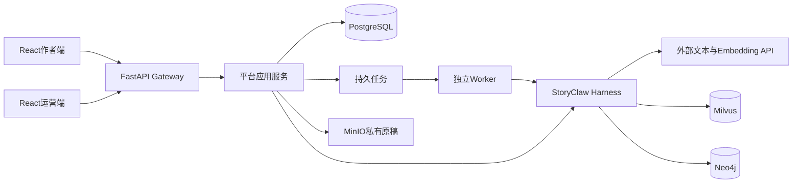

# 04 系统架构与运行原理

## 一次写作请求经过哪里

浏览器只访问平台API，不持有供应商密钥，也不直接连接数据库。AI包由API/Worker的Python进程导入，不是另一个HTTP微服务。

## 为什么后端里有app和packages

`app`回答：谁能操作、如何读写SQL、怎样排队、需要谁确认、积分如何结算。`packages/harness/storyclaw`回答：怎样理解创作要求、选择能力、组织提示、执行Graph、生成内容和检索证据。

依赖方向为`app → storyclaw`。AI包通过Ports和注入回调使用平台能力，不能反向导入`app`、FastAPI或SQLAlchemy。平台也不直接调用LangChain的`ainvoke/astream`；模型推理在AI包中完成。这些边界由自动测试检查。

例子：AI提出“读取上一章”，调用工具；平台适配器先检查用户、作品与章节范围，再读取资料返回。AI不能通过一句提示绕过权限。

## API和Worker为什么分开

API接收HTTP请求并返回数据、事件或任务编号。Worker执行持久化队列，负责需要较长时间的生成、来源处理、索引、发布与清理。它们安装相同代码，角色不同。

页面切换后，从SQL任务和事件恢复状态，不应重新提交同一个付费请求。不是每个API都排队：只读状态及部分短操作可以直接执行；长创作操作以任务为主。

## 启动时做什么

`app.main:app`转出`app.gateway.app`的ASGI应用。lifespan创建开发期缺失表、加载数据库平台配置、构建检查点并注入模型/上下文/工具回调。

Compose将API的`WORKERS_ENABLED`关闭，独立Worker显式开启消费者，并写心跳健康文件。数据库仍是任务事实源，不靠浏览器内存或页面Tab保存执行状态。

目前启动时AI依赖初始化失败会记录警告，基础API仍可能启动。因此`/health`成功不能代替真实创作检查。这是当前需要继续改进的就绪检查边界。

## 容器和数据

Docker容器是同一台主机上隔离的进程环境，不是每个容器各有一台完整虚拟机。Linux服务器运行Docker；macOS开发时通常由Docker Desktop的Linux虚拟机承载。

容器内部可以都使用8000，只要宿主机发布端口不冲突。内部服务名用于容器间通信。数据库卷在容器之外持久化；删除或重建容器不等于删除卷。

容器拆分有利于升级和职责隔离，但同机部署仍共享CPU、内存、磁盘和故障域，不等于高可用。

源码依据：[启动装配](../backend/app/gateway/app.py)、[Worker](../backend/app/worker.py)、[Ports适配](../backend/app/adapters/storyclaw/agent.py)、[依赖契约](../backend/packages/harness/storyclaw/runtime/deps.py)。

---

[上一篇：03-源码目录与阅读路线](03-源码目录与阅读路线.md) · [下一篇：05-作者使用与小说创作流程](05-作者使用与小说创作流程.md) · [阅读导航](00-阅读导航.md)
