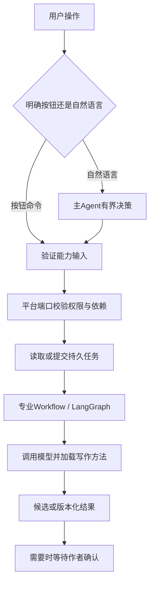

# 06 Agent、工作流与Skill原理

## 五个概念各负责什么

| 概念 | 当前职责 | 例子 |
| --- | --- | --- |
| StoryClaw门面 | 统一请求入口与能力调用，提供运行/事件/取消等接口 | `StoryClaw.run()` |
| Agent Loop | 根据观察决定下一步能力，有界执行，不拥有业务权限 | 自然语言“看看缺什么，再规划本章” |
| Workflow / Graph | 用代码约束已知步骤、状态和验证 | 选题采访、正文writer/reviewer图、逐章规划 |
| Tool / Capability | 可调用的明确功能、输入schema与风险属性 | `memory.search`、`chapter.plan` |
| Skill | 创作方法、约束、示例和参考材料 | 章节技法、角色弧线、一致性审阅 |

Skill不负责扣费、数据库写入或任务调度。Workflow可以加载Skill；Agent可以调用Workflow对应的能力，因此它们不是三份重复实现。

## 两条执行路径

明确点击“生成章纲”没有必要先让主模型猜意图，可以直接走command。自然语言入口才需要主循环协调。首页选题有自己的专用流程，并非所有旧接口都强制绕一遍主Loop；最终复用生成、权限和计量能力。

## 主循环的实际约束

公开类位于`agents/lead_agent/agent.py`，默认最多6轮，每轮最多处理4个模型工具请求，按顺序观察；相同工具和参数重复超过2次会停止。遇到作者确认、候选产物或持久等待即返回，不在模型里无限轮询后台任务。

平台适配器验证用户、书籍和章节scope；能力目录声明schema及是否需要任务/覆盖确认。模型说“已经确认”不能代替服务器存储的作者决定。

## 专业图与工具循环

`agents/graph.py`组装章节Agent节点，包含supervisor、analyst、researcher、writer、reviewer等职责；具体分支由请求意图决定，不是每个操作都遍历所有节点。

`tools/writing.py`定义写作工具和有界工具循环。`workflows/`包含总纲、章纲、设定、场景、来源处理等专业逻辑；`runtime/execution.py`提供实际执行与流。后端仍负责落库、版本保护、任务和费用。

## 11份内置写作方法

核心8份：`framework-design`、`world-design`、`character-arc`、`plot-design`、`chapter-craft`、`prose-editing`、`continuity-review`、`story-summarization`。

按需3份：`idea-generation`、`naming`、`scene-and-dialogue`。

它们存于`storyclaw/skills/resources`，包括SKILL.md、manifest.json及references，随wheel安装。旧方法名通过alias转到当前方法，旧归档不会作为运行资源加载。

方法内容具有版本/哈希。排队期间方法变更会触发校验；私人方法也只作为资料，不执行任意脚本。现有方法加载器不是给用户安装任意可执行插件的框架。

## 按这个顺序读源码

1. [公开门面](../backend/packages/harness/storyclaw/agents/lead_agent/agent.py)：理解command和chat的差异。
2. [能力目录](../backend/packages/harness/storyclaw/orchestration/capabilities.py)：看前端操作能调用什么。
3. [平台Ports适配](../backend/app/adapters/storyclaw/agent.py)：理解权限、任务和确认落在哪里。
4. [专业图](../backend/packages/harness/storyclaw/agents/graph.py)及`workflows/`：看具体步骤。
5. [方法加载器](../backend/packages/harness/storyclaw/skills/loader.py)：理解方法如何进入提示。

不要把归档中的全部远期场景当作门面已经实现的全部能力。当前边界见[13](13-已知限制与后续路线.md)。

---

[上一篇：05-作者使用与小说创作流程](05-作者使用与小说创作流程.md) · [下一篇：07-上下文记忆与三库设计](07-上下文记忆与三库设计.md) · [阅读导航](00-阅读导航.md)
