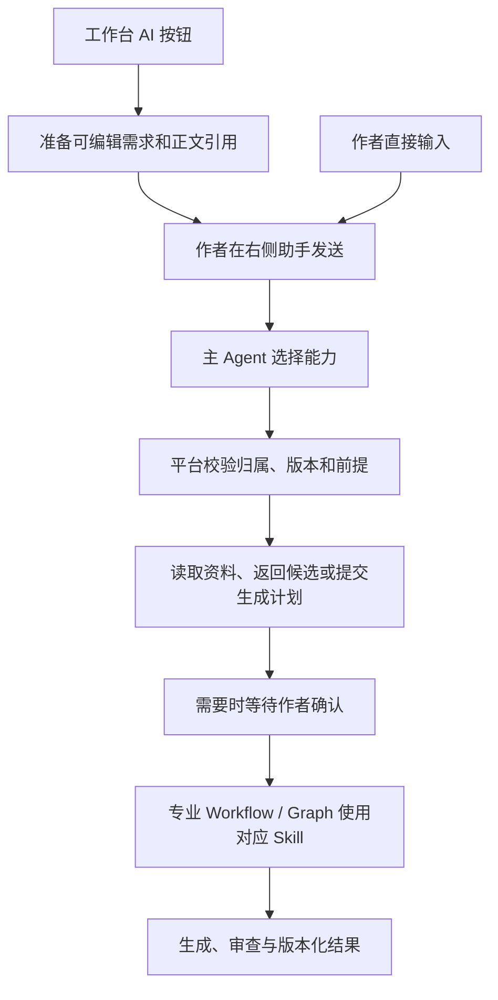

# 06 Agent、工作流与Skill原理

## 五个概念各负责什么

| 概念 | 当前职责 | 例子 |
| --- | --- | --- |
| StoryClaw门面 | 统一请求入口与能力调用，提供运行/事件/取消等接口 | `StoryClaw.run()` |
| Agent Loop | 根据观察决定下一步能力，有界执行，不拥有业务权限 | 自然语言“看看缺什么，再规划本章” |
| Workflow / Graph | 用代码约束已知步骤、状态和验证 | 选题采访、正文writer/reviewer图、逐章规划 |
| Tool / Capability | 可调用的明确功能、输入schema与风险属性 | `memory.search`、`chapter.plan` |
| Skill | 创作方法、约束、示例和参考材料 | 章节技法、角色弧线、一致性审阅 |

Skill不负责扣费、数据库写入或任务调度。Workflow可以加载Skill；Agent可以调用Workflow对应的能力，因此它们不是三份重复实现。

## 作者入口与内部执行路径

工作台 AI 按钮先准备右侧助手草稿，作者修改并发送后，由主 Agent 选择能力；按钮不直接开始付费生成。内部仍保留明确 command 调用，供确定性工作流和兼容接口复用。



首页开书讨论保留专门的访谈流程。无论入口怎样组织，Skill 都只提供专业方法，不取得保存、确认、扣费或发布权限。

## 主循环的实际约束

公开类位于`agents/lead_agent/agent.py`，默认最多6轮，每轮最多处理4个模型工具请求，按顺序观察；相同工具和参数重复超过2次会停止。遇到作者确认、候选产物或持久等待即返回，不在模型里无限轮询后台任务。

平台适配器验证用户、书籍和章节scope；能力目录声明schema及是否需要任务/覆盖确认。模型说“已经确认”不能代替服务器存储的作者决定。

## 专业图与工具循环

`agents/graph.py`组装章节Agent节点，包含supervisor、analyst、researcher、writer、reviewer等职责；具体分支由请求意图决定，不是每个操作都遍历所有节点。

`tools/writing.py`定义写作工具和有界工具循环。`workflows/`包含总纲、章纲、设定、场景、来源处理等专业逻辑；`runtime/execution.py`提供实际执行与流。后端仍负责落库、版本保护、任务和费用。

## 11 份内置写作方法（2026-10-27 重写）

11 个 SKILL.md、22 份参考材料和 11 个 manifest 已整体替换，方法版本升为 2。保留原标识、别名与调用能力映射；归档不是运行资源。正文方法每份约 1200–1600 字符，另有按子任务选择的详细材料；信息密度和任务适配优先于篇幅。

| 方法入口 | 主要职责 |
| --- | --- |
| [framework-design](../backend/packages/harness/storyclaw/skills/resources/framework-design/SKILL.md) | 总纲、分卷、连载阶段与定长结构 |
| [plot-design](../backend/packages/harness/storyclaw/skills/resources/plot-design/SKILL.md) | 章纲、场景任务、主支线与伏笔生命周期 |
| [character-arc](../backend/packages/harness/storyclaw/skills/resources/character-arc/SKILL.md) | 人物档案、动机、关系、声音与弧光 |
| [world-design](../backend/packages/harness/storyclaw/skills/resources/world-design/SKILL.md) | 世界规则、组织资源与可行动的空间 |
| [chapter-craft](../backend/packages/harness/storyclaw/skills/resources/chapter-craft/SKILL.md) | 完整章节、具体行动与授权范围内修订 |
| [continuity-review](../backend/packages/harness/storyclaw/skills/resources/continuity-review/SKILL.md) | 双端证据、知情边界、事件重复与最小修复 |
| [story-summarization](../backend/packages/harness/storyclaw/skills/resources/story-summarization/SKILL.md) | 读者回顾、阶段记忆与来源化事实 |
| [prose-editing](../backend/packages/harness/storyclaw/skills/resources/prose-editing/SKILL.md) | 选区语义保留、光标前后文与扩缩写 |
| [scene-and-dialogue](../backend/packages/harness/storyclaw/skills/resources/scene-and-dialogue/SKILL.md) | 空间氛围、人物诉求、对白信息与潜台词 |
| [idea-generation](../backend/packages/harness/storyclaw/skills/resources/idea-generation/SKILL.md) | 差异化创意、可持续冲突与方案收敛 |
| [naming](../backend/packages/harness/storyclaw/skills/resources/naming/SKILL.md) | 命名对象、语感、区分度与剧透检查 |

每份方法包含用途与输入、具体方法、边界、输出要求和参考路由；参考包含工作单、判断示例和反例。已去掉固定分卷章数、短梗概上限、固定转折数等与当前生成计划冲突的模板。故事规模、字数和正式输出 schema 仍由作者选择及能力代码决定，Skill 不另建接口。

### 两种加载方式

- 专业 Workflow 调用 `method_instructions`：注入 Parameters、Method、Constraints、Output，以及 manifest 的 `instruction_references` 指定材料。内置模式每次预载一至两份参考；修订、润色、续写、场景与对白分别选材。旧自定义 Skill 没有该字段时沿用原加载方式。
- 助手先用 `skills.list` 发现方法，再用 `skills.read` 读取主文档；需要细节时填写 `reference`，读取 `reference_files` 中的一份材料。不能读取任意路径、跨目录文件或未登记参考。

```json
{"name":"plot-design"}
```

```json
{"name":"plot-design","reference":"references/plot-beats-reference.md"}
```

方法及参考内容共同参与版本哈希，变更参考也会触发资源版本变化。随 wheel 安装的文件必须与源码一致，不依赖运行工作目录。增加参考时，同时登记 manifest、主文档链接与需要自动注入的任务路由；不要把所有参考全文默认注入每次请求。

方法是模型的工作指导，不是算法保证。人物状态持久化、Token 总预算和全书一致性校验仍需由代码和真实质量评估验证，不能仅凭重写 Skill 宣称已解决。

## 按这个顺序读源码

1. [公开门面](../backend/packages/harness/storyclaw/agents/lead_agent/agent.py)：理解command和chat的差异。
2. [能力目录](../backend/packages/harness/storyclaw/orchestration/capabilities.py)：看前端操作能调用什么。
3. [平台Ports适配](../backend/app/adapters/storyclaw/agent.py)：理解权限、任务和确认落在哪里。
4. [专业图](../backend/packages/harness/storyclaw/agents/graph.py)及`workflows/`：看具体步骤。
5. [方法加载器](../backend/packages/harness/storyclaw/skills/loader.py)：理解方法如何进入提示。

不要把归档中的全部远期场景当作门面已经实现的全部能力。当前边界见[13](13-已知限制与后续路线.md)。

---

[上一篇：05-作者使用与小说创作流程](05-作者使用与小说创作流程.md) · [下一篇：07-上下文记忆与三库设计](07-上下文记忆与三库设计.md) · [阅读导航](00-阅读导航.md)
