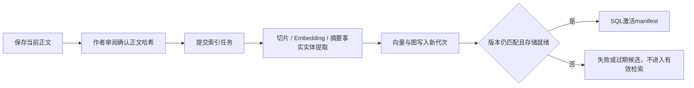

# 07 上下文记忆与三库设计

## 三个数据库不是存三份“同样的小说”

| 存储 | 保存什么 | 角色 |
| --- | --- | --- |
| PostgreSQL | 用户、作品、正文、版本、设定、章纲、确认、任务、积分、索引清单与事实记录 | 平台事实源 |
| Milvus | 正文切片的向量与来源信息 | 语义相近的历史证据检索 |
| Neo4j | 带章节/代次来源的实体和关系 | 关联证据检索 |
| MinIO | Milvus所需对象数据、平台私有原稿文件 | 对象存储，非第四份关系数据库 |

数据库不自动理解小说。文本模型提取摘要、实体与事实，Embedding模型生成向量；存储与查询再把证据取回。取回的证据需要筛选和审阅，不能直接当成不会出错的记忆。

## 正文什么时候进入向量与图数据库

生成或手写正文首先保存到PostgreSQL。此时通常是待审阅/待索引状态，**不是保存即成为有效检索资料**。

当前切片器先清理HTML、按段落切分，超长文本使用512字符窗口和64字符重叠。这是字符规则，不是512个token；提取任务的分段策略与向量切片不是同一个参数。

每次新索引有独立物理代次。SQL清单关联正文版本及存储结果，防止新代次尚未完成时污染旧资料。作者在索引期间改稿，会使旧结果不能按新正文激活。

## 每次写章到底读哪些信息

| 场景 | 核心参考 |
| --- | --- |
| 第一章 | 作品资料、确认总纲、世界/人物等设定、本章章纲、方法、可选场景计划 |
| 第二章 | 上述内容，加第一章当前有效正文及记忆 |
| 后续章节 | 当前章纲、最近上一章正文、有限历史检索、有效摘要/事实、来源基线与分支规则 |
| 续写本章片段 | 当前正文/指定片段、当前约束，返回候选 |
| 改旧章后继续 | 先处理失效记忆、受影响后文章纲和复核提示，再使用新版本 |

上下文不是全量历史正文。最近上一章文本最多取12000字符；作品简介、设定、切片数量与证据长度也有限制。普通长篇不会每次将全部章节读入模型。检索结果太少不等于历史中从未发生过某事。

## 防止未来章节和跨作品信息混入

检索按用户、作品或来源命名空间、有效代次与允许章节范围过滤；范围条件在向量top-k之前应用。未来章节和失效索引不能因为语义接近就被当作当前事实。

原作来源使用独立的`source_<uuid>`空间；新创作作品独立存储。分支基线决定允许引用的截止位置和规则，不直接修改原作索引。

## 改稿为什么影响后文

本章章纲保存对总纲、设定、历史、方法、来源基线与视角规则的依赖指纹。历史使用增量前缀哈希：追加处理尾部，修改/删除早期章节使后缀失效，索引代次也参与依赖。

因此，“正文文本没有变”不代表全部上下文没有变；例如确认事实或更新有效索引，也可能改变后文章纲参考。系统不会自动帮作者决定所有剧情变化，而是阻止静默沿用过期计划。

## 叙事事实、人物知情和因果

叙事记忆提供别名映射、候选/确认/排除、来源引用、知情人物、公开常识、信念持有者、故事时间、有效章节与显式因果边。每章可以选择人物视角，结构化资料按规则筛选。

角色相信某件事不代表它是客观事实。别名冲突、跨书或未来原因、因果环会被拒绝。但原文检索与模型本身仍可能暴露角色不知道的信息，需要作者审阅，不应宣传为已经解决所有一致性问题。

## 删除、回收与恢复

退役索引和孤儿原稿通过SQL清理outbox延迟回收，当前保留期24小时；执行前复核有效引用，失败保留记录并退避重试。共享来源仍被分支引用时不能任意删除。

备份应覆盖SQL和私有原稿，以及所需知识存储状态。仅保留容器镜像无法恢复用户作品；索引是否能重建还依赖保留的正文、原稿、模型和确认资料。

源码依据：[上下文组合](../backend/packages/harness/storyclaw/context/writing_context.py)、[RAG入口](../backend/packages/harness/storyclaw/rag/service.py)、[切片器](../backend/packages/harness/storyclaw/rag/chunker.py)、[索引清单](../backend/app/services/knowledge/index_manifest.py)、[章纲依赖](../backend/app/services/writing/serial.py)。

---

[上一篇：06-Agent工作流与Skill原理](06-Agent工作流与Skill原理.md) · [下一篇：08-任务确认与积分计量](08-任务确认与积分计量.md) · [阅读导航](00-阅读导航.md)
