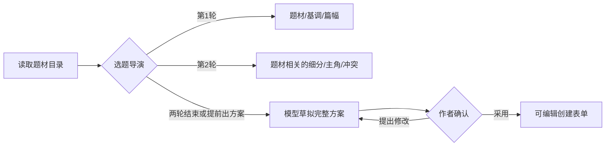

# 有边界的选题工作流

## 作者怎么使用

默认只做两轮集中选择，低于“三轮以内”的上限。

1. **第一轮：方向。** 主类型、阅读基调、篇幅。已明确识别的单一题材不再重复问主类型。
2. **第二轮：故事骨架。** 根据题材给出细分方向、主角位置和核心冲突。历史会提供架空历史、真实朝代、历史脑洞等方向，不会突然问修炼体系；玄幻也不会套用历史问卷。
3. **直接出方案。** 给出书名、简介、主角与篇幅，作者可以采用进入创建表单，或点击修改并说明改哪里。之后默认修改方案，不重新采访。

每题均可写其他答案，不确定可选择由 AI 建议，也可以提前点“直接给我方案”。前两轮是本地题材工具提供的固定分组，不调用付费模型；生成和修改方案才按模型用量结算。确认创建仍由作者执行。

## 实现方式

独立的 LangGraph 工作流位于 `backend/app/services/ideation_workflow.py`。它使用题材目录工具、阶段路由、分组问题工具和草拟方案工具；阶段由服务端控制，模型不能自行扩大提问轮数。

工作流不是开放式自主循环：一次请求只推进一个阶段，后台不会无限追问或自动开书。`IdeationSession` 在 PostgreSQL 保存已确认答案、轮数、历史与当前方案，刷新不会靠前端猜测进度。原有请求编号去重、流式输出、格式校验和积分事务继续保留。迁移为 `0010_ideation.py`。

## 题材来源与整理边界

2026-10-24 查阅并在浏览器展开了[番茄官方书库的“主题”分类](https://fanqienovel.com/library)，可见标签包括：玄幻、历史、都市、现代言情、古代言情、武侠、体育、东方玄幻、高武世界、异世大陆、都市异能、职场商战、赛博朋克、末日求生、悬疑、架空、宋朝、清朝、幻想言情等。

同时参考[起点公开分类](https://www.qidian.com/ask/qqbclwzostugt)中的玄幻、奇幻、武侠、仙侠、都市、现实、军事、历史、游戏、体育、科幻、诸天无限、悬疑、轻小说。

应用采用便于开书选择的编辑映射：先选 17 个主类型，再选择相关细分，不将主类型、年代、角色、情节标签混成一个平面列表。这是参考平台后的应用分类，不声称完整复制任何平台后台分类，不代表投稿后会自动归入相同官方分类。

## 验证

隔离数据库测试覆盖两轮结束、提前生成、修改不重问、按题材提供问题、服务端会话归属、重试不重复推进或扣费。真实浏览器验证了“历史 → 架空历史 → 经营者 → 种田经营 → 40章方案”，并继续测试定向修改。

## 篇幅的含义

篇幅问题询问整本书的暂定总字数，提供短篇、中篇、10–30万字、100万字、200–300万字及暂不确定选项，可自填其他目标。它用于估算全书章数，不是一次生成量，也不是作品的字数上限。方案分别显示全书目标和每章字数；不确定时 AI 必须标注建议为暂定。建议先打磨开篇或第一卷，再在创作台逐章生成正文；本次选题不会批量生成所有章节。
