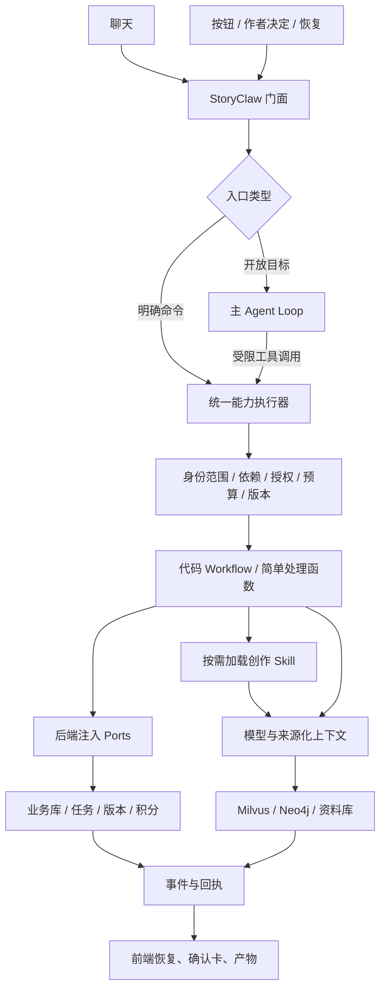

# StoryClaw 创作 Agent 统一设计

> 历史归档：保留当时方案或验证结果，不代表当前实现。现行说明从[阅读导航](../../00-阅读导航.md)开始；文中旧命令不应直接照做。

> 版本：设计基线 v6，2026-10-25。本文统一替代此前按轮次追加的设计，不表示已实现。
> 实施进度：统一门面、方法迁移、接管/分支、连续计划和投稿包已经接入。实际验证和未完成边界见 [重构实施记录](../records/01-Agent重构验收记录.md)。本文其余内容仍为目标设计，不表示全部功能已完成。
> 配套：[用户场景与验收目录](02-用户场景原始清单.md)；[当前源码职责](../../03-源码目录与阅读路线.md)。
> 范围：React 作者端、独立运营端、FastAPI 平台服务、backend/packages/harness AI 包；保留 PostgreSQL、Milvus、Neo4j。

## 阅读导航

- 产品与边界：第 1—2 节。
- 类、能力、Skills 与工作流：第 3—7 节。
- 确认、记忆、长篇接管与同人：第 8—11 节。
- 任务可靠性、前端和发布：第 12—15 节。
- 数据、迁移、验收与设计评价：第 16—19 节。

## 1. 产品目标与完成标准

StoryClaw 是作者掌握创作决定的长期小说创作与连载生产平台。支持三种模式：

| 模式 | 用户目标 | 必须具备的能力 |
| --- | --- | --- |
| 原创新书 original_new | 从想法到逐章写作、修改、投稿 | 有限选题、总方向、角色/规则、逐章确认、审阅与发布快照 |
| 旧作接管 original_takeover | 导入既有 100 万字，再续写 300 万字 | 拆章/版本映射、分析覆盖、接管基线、风格对齐和连续记忆 |
| 衍生创作 derivative | 基于可使用的 500 万字原作创作新长篇 | 只读来源、独立分支、继承/覆写、时间与角色知识隔离 |

字数目标分 existing_words、additional_target_words、estimated_final_words；100 万+300 万是预计总共 400 万，不等于续写至总共 300 万。章数可变，长期目标不生成全部细纲。

技术上支持数百万字，不等于每章质量可靠或保证商业成功。必须分别验证容量、来源、连贯性、文学审阅、发布准备与实际市场结果。本站公开阅读也不等于已经有作者付费分账业务。

本设计不承诺全部可能需求、零矛盾、自动签约/盈利，也不以“存在 Skill 文件”证明功能可用。配套场景目录按实现与验收状态管理。

## 2. 架构选择与职责边界

选择：**一个 StoryClaw 门面 + 一个创作主 Agent Loop + 一套统一工具/能力 + 代码实现的 Workflow + 按需加载的创作 Skill**。

统一调用关系：**Agent 调工具，工具执行 Workflow，Workflow 按需加载 Skill。明确按钮直接调同一工具/能力。** 查询与普通 CRUD 可以直接执行确定性函数，不必经过模型或复杂工作流。这里“工具/能力”是同一注册动作的不同呈现：能力是执行合同，工具是暴露给 Agent 的调用接口，不另造两套业务实现。

- 开放聊天由主 Agent 理解目标、读状态、查询、提问和协调工作流。
- 明确按钮直接执行同名能力，不额外花模型调用判断按钮意图。
- 确认、手动保存、权限、结算和发布状态由程序决定。
- 长任务交给持久队列；等待用户或任务时不维持模型轮询。
- 聊天、按钮、恢复入口共用能力实现、授权、来源和版本规则。



| 归属 | 负责 | 不负责 |
| --- | --- | --- |
| storyclaw 包 | 主循环、领域工作流、提示、Skills、参考组合、语义策略、检索算法 | JWT、直接修改业务 ORM、积分账户、HTTP 组件 |
| backend | 身份/权限、SQL、持久 Run/Job、事务、预算/结算、模型连接解析、事件传输 | 在路由里复制一套提示和 Agent 逻辑 |
| frontend | 编辑器、选区、问题卡、差异采用、任务展示、重连 | 自报可信用户/确认权限、猜测后端成功 |
| admin-frontend | 用户、模型、日志、订单、积分等管理 | 向作者 Agent 暴露管理员工具 |

AI 包不 import backend.app、FastAPI 或业务 SQLAlchemy 模型。AI 算法通过领域 DTO 与 Ports 请求数据和提交变更；后端适配器再次验证写入前提，模型不能绕过。

首期不增加多层子 Agent、任意 shell 或代码执行沙箱。小说业务先把来源、版本、确认和长期状态做可靠；以后只有独立研究/审稿确有收益时再加入受限子 Agent。

## 3. StoryClaw 类与领域契约

### 3.1 门面接口

下列是目标接口示意，不是当前可直接运行代码。

```python
class StoryClaw:
    def __init__(self, *, ports: StoryPorts, models: ModelProvider,
                 capabilities: CapabilityRegistry,
                 workflows: WorkflowRegistry, policy: ExecutionPolicy): ...

    async def run(self, request: AgentRequest,
                  context: ExecutionContext) -> RunSnapshot: ...
    def stream(self, request: AgentRequest,
               context: ExecutionContext) -> AsyncIterator[AgentEvent]: ...
    async def resume(self, run_id: str, decision: AuthorDecision,
                     context: ExecutionContext) -> RunSnapshot: ...
    async def cancel(self, run_id: str,
                     context: ExecutionContext) -> RunSnapshot: ...
    async def status(self, run_id: str,
                     context: ExecutionContext) -> RunSnapshot: ...
    def events(self, run_id: str, after_seq: int,
               context: ExecutionContext) -> AsyncIterator[AgentEvent]: ...
```

`run` 执行到一次可让出控制权的节点，返回完成/等待/失败快照，不意味着一个 HTTP 请求跑完整本书。`stream` 提供该次执行事件；长期任务由 `events` 订阅。类不保存当前用户、书籍等可变全局状态，所有调用显式传上下文，便于并发隔离和单元测试。

### 3.2 内部组件

| 组件 | 唯一职责 |
| --- | --- |
| RequestRouter | chat/command/decision 分流；模糊目标缺 scope 时澄清 |
| LeadAgent | 有界工具循环，协调开放目标 |
| CapabilityRegistry / Executor | 能力元数据、参数校验、前置条件、执行和回执 |
| WorkflowRegistry | 固定流程实现选择与版本管理 |
| SkillRegistry | 方法/提示资源发现、信任和版本管理 |
| ContextBuilder | 按场景构建来源化、预算内参考 |
| PolicyEngine | 依赖、授权、采用、预算、停止规则 |
| RunController | 状态转换、暂停、唤醒、取消和配置快照 |
| EventRecorder / UsageTracker | 持久事件、调用用量与后端结算数据 |

类作为门面组合这些组件，不把提示词、数据库或 UI 逻辑全部写在同一文件。

### 3.3 请求与标识

AgentRequest：request_id、entry、message 或 command/payload、conversation_id、scope、expected_versions、limits、source（具体按钮/页面）。ExecutionContext 由后端构建真实 actor/角色/租户、权限和追踪信息，不信任请求体 user_id。

scope 包含 book_id、chapter_id、selection、chapter_range，以及 source_corpus_id、branch_id、baseline_version、read/write 用途。首页讨论可无书籍；写作操作不能靠模型从书名猜数据库 ID。切换书籍不会改变已提交 Run 的 scope。

| ID | 含义 |
| --- | --- |
| conversation_id | 长期对话串，可跨多次目标 |
| run_id | 一次目标执行，例如改第三章 |
| step_id / tool_call_id | 一次能力执行 |
| job_id | 可后台运行的持久任务 |
| artifact_id | 候选、章纲、报告、差异或导出产物 |
| decision_id | 问题/确认卡 |
| operation_key | 副作用去重键：Run/Step/动作/输入版本哈希 |

### 3.4 状态与成功含义

Run：accepted → running → waiting_author / waiting_task → running → succeeded；另有 partial、failed、cancelled。blocked_reason 保存缺前提、配额等具体原因。cancel_requested 是标志，不宣称外部请求已撤回。

产物采用状态：draft / confirmed / applied / superseded；依赖有效性：current / stale。正文审阅、正式采用、索引完成、平台发布是独立状态。任务 succeeded 只说明对应执行合同完成，残余字数/质量问题通过 warnings 展示，不等于出版质量通过。

## 4. 主循环、能力和模型边界

### 4.1 一轮调度

验证 scope 与请求幂等 → 读最新权威状态/配置快照 → 加载能力索引和必要 Skills → 模型决定回答/查询/提问/执行 → 参数与策略校验 → 执行能力 → 记录真实回执 → 继续或暂停。

主 Agent 对外展示行动摘要和来源，不输出隐式推理。不能根据模型“我已保存/入库”改变实际状态。工具错误用结构化 code 返回，例如 prerequisite_missing、version_conflict、quota_exhausted。

建议初始限制：普通请求最多 6 轮工具决策、复杂目标最多 12 轮；常规检索 3 次；同工具同参数同结果重复 2 次触发停滞检测。工作流最多一次自动正文修订。预算、deadline 和任务范围优先于轮数；这些为拟定默认值，需用实际完成率校准。

作者运行中补充约束形成请求版本：尚未执行步骤更新；已经运行的工作流不能假装看过新要求，其结果标需核对或重新生成候选。当前步骤取消和整个计划取消分开。

### 4.2 能力执行契约

每项能力声明：name/version、输入/输出 schema、scope、前提、读写级别、确认需求、模型/Skill 需求、后台执行方式、幂等、取消点、恢复和 UI 产物类型。

统一结果：status、artifact_refs、evidence_refs、job_id、usage、warnings、error、next_actions。初期不做通用工作流 DSL 或运行时任意图生成；使用类型化 Python 适配器和明确流程。

能力组：

| 组 | 能力与副作用 |
| --- | --- |
| 查询 | project.status、material.read、memory.search、knowledge.status、coverage.inspect；只读 |
| 交互 | author.ask、方案卡；持久化后暂停 |
| 开书 | ideation.discuss、book.propose；book.create 只消费有效作者决定 |
| 规划 | framework.draft、chapter.plan、chapter.scenes；返回草稿 |
| 档案 | setting.draft、setting.propose_change；采用为独立命令 |
| 写作 | chapter.write、chapter.revise、text.continue、text.polish；按授权保存版本/候选 |
| 分析 | book.analyze、chapter.review、impact.assess、narrative.review_arc；报告不直接改事实 |
| 知识 | knowledge.ingest/rebuild；绑定审阅版本与来源许可 |
| 连载 | serial.advance；限定章数、预算、采用策略 |
| 接管 | import.preview/apply/analyze/status、baseline.propose、continuation.prepare |
| 分支 | canon.branch.propose、canon.inspect；分支采用为作者命令 |
| 生产 | export.prepare、publication.prepare/status；外站提交受独立授权 |

确认/采用、删除、发布、积分调整和密钥管理不作为模型可自授权的通用写工具。模型可以提议，后端只接受相应真实用户动作。

### 4.3 模型能力要求

上线前探测工具调用、结构化输出、流式、上下文和用量字段；模型与执行配置固定到 Run。工具不稳定的模型只用于已验证直接工作流或文本建议，不能靠解析一句自然语言“执行成功”模拟工具回执。

截断响应中的不完整工具/JSON 不执行；有限修复受预算控制，缺失必要信息不编造。换模型/升级 Skill 的重新生成是新 attempt，保留旧回执，不静默替换。

## 5. Skill 体系：方法不是业务权限

### 5.1 四个概念分开

| 概念 | 回答什么问题 | 示例 |
| --- | --- | --- |
| Agent | 下一步该做什么 | 先看前文还是问作者 |
| Capability | 系统承诺能执行什么 | chapter.write |
| Workflow | 必须按什么步骤执行 | 确认检查→参考→生成→审核→写回 |
| Skill | 这件创作工作如何做得好 | 写章方法、对白技巧、一致性清单 |

一个 Workflow 可以加载多项 Skill，同一 Skill 可以供多个 Workflow 使用；简单能力允许不加载 Skill。Skill 文档没有数据库写权限，也不能改变确认、预算或检索边界。它写“保存到表”“失败后跳到下一章”不会取代程序策略。

**执行规则只在代码中维护，创作方法在 Skill 中维护；同一条执行规则不在两处各写一份。** Skill 中可以描述模型侧步骤，例如“辨认对白的信息点，再调整潜台词”，但不能写数据库事务、后台任务重试、人工确认或跳过历史依赖。

### 5.2 已核对的 17 项旧 Skill：功能保留不等于目录全部保留

当前“有处理分支”不等于输出格式、落库和 UI 已完整符合旧 SKILL.md。下表按源码而非文档承诺判断；“建议/报告”与“正式修改”分开。

| 现有 Skill | 当前代码路径/状态 | 目标能力、入口和产物 | 采用与必须调整 |
| --- | --- | --- | --- |
| write-chapter | Writer 写章；读取技能段落，已有工具和 RAG 参考 | chapter.write；写本章/聊天；正文版本 | 删除旧“无 RAG/仅摘要”描述；遵守已确认章纲和来源边界 |
| modify-chapter | Writer 改章，有有限审核修订 | chapter.revise；重写/修改需求；候选或授权新版本 | 局部要求不能默认整章覆盖；提供范围/差异，残余问题不伪通过 |
| continue-writing | Writer 段内续写 | text.continue；光标/聊天；片段候选 | 固定光标与原文版本，用户采用后保存；保存不等于索引入库 |
| polish-chapter | Writer 选区润色 | text.polish；选区菜单；片段候选 | 无选区先澄清，防止误走整章修改；采用版本保护 |
| continue-chapter | 后端识别下一章并复用写章，非独立节点 | continuation.prepare + chapter.plan/write；下一章入口 | 合并为流程/命令别名，退役独立 Skill；保留前端功能，检查章纲与授权 |
| write-multi-chapters | 有旧批量接口；连载模式已拒绝该旧路径 | serial.advance；连续推进任务；逐章回执 | 迁入 W10，退役独立 Skill；失败停止、预算和采用策略由代码保证 |
| outline-planning | 大纲图；Analyst 另有预览路径 | framework.draft；大纲按钮/聊天；统一大纲草稿 | 两入口收敛；默认连载方向/阶段，定稿才全章计划；无模板伪成功 |
| plot-planning | Analyst 分支，主要为报告输出 | plot.plan / chapter.plan；情节助手；阶段或本章草案 | 不默认所有未来章；分析报告与情节卡采用分开 |
| character-development | Analyst 角色弧光报告 | character.arc；角色页/助手；弧光建议 | 不是角色卡 CRUD；作者选择采用的字段才触发设定变更 |
| consistency-check | Analyst 分支，注入范围文本/参考生成报告 | chapter.review / book.analyze / impact.assess | 对结构化问题逐项验证来源；不得把 prompt 中“扫描全书”当真实覆盖 |
| book-summary | Analyst 摘要报告；现上章参考还含确定性截取 | book.summarize；前情/接管/阶段；带来源摘要 | 读者摘要与内部事实摘要分型；版本化缓存；不能自动当已确认事实 |
| brainstorm | Assistant 固定处理分支 | idea.brainstorm；首页/卡文；创意候选 | 不自动建卡；采纳时再进入对应能力 |
| title-generation | Assistant 固定处理分支 | title.suggest；书名/卷名/章名；候选列表 | 选中后确定性改名及影响检查，不模型直接改目标 |
| scene-enhance | Assistant 固定处理分支 | text.scene_enhance；选区/助手；片段候选 | 区别于章内场景任务单、场景档案卡，采用规则同局部编辑 |
| dialogue-polish | Assistant 固定处理分支 | text.dialogue_polish；选区/助手；对白候选 | 保留事实和角色声音，按选区采用，不全章误替换 |
| reading-config-gen | Assistant 固定分支生成配置文本 | reading.config_suggest；阅读设置；校验后的配置候选 | 普通夜间/字号优先确定性预设；AI 可选，严格字段白名单 |
| skill-creator | 有说明文件；未见对应专用可写业务处理分支 | skill.propose；受限自定义模板功能；Skill 草案 | 首期只允许生成/预览私有提示模板；不宣称已能创建并执行任意 Skill |

尤其发现旧文档与规则冲突：全书固定章纲、模板兜底、下一章自动写回、失败跳过、润色“接受后入库”等表述必须更新。助手中的固定 prompt 与 Writer/Analyst 的 Skill 段落加载方式不一致，也需要统一；不能只搬目录就认为完成技能迁移。

### 5.3 Skill 目标清单与取舍

不是删除大多数功能，而是合并重复方法、把执行逻辑移回代码。目标为 **8 个核心方法包 + 3 个按需辅助包**；11 是当前业务的维护划分，不是固定数量指标。世界观方法原先只隐含在 design/prompt 中，本次明确为 world-design，避免精简时漏掉规则构建。

| 优先级 | 目标 Skill | 负责的创作方法 | 典型调用和边界 |
| --- | --- | --- | --- |
| 核心 | framework-design | 故事承诺、核心冲突、阶段目标、连载/定稿结构 | W2；不提前强制生成所有章纲 |
| 核心 | world-design | 时代社会、地理组织、力量/技术边界、代价和规则的可验证性 | W3 设定草案；现实题材不强塞修炼体系；不自行确认设定 |
| 核心 | character-arc | 动机、人物选择、关系变化、成长与角色声音约定 | W3/角色弧光报告；设定人物不等于正文已经发展到终态 |
| 核心 | plot-design | 主支线、场景目标、阻碍、转折、因果、伏笔与接续点 | W4/W5/阶段规划；规划不是历史事实 |
| 核心 | chapter-craft | 把确认计划写成行动和场景，控制视角、节奏、信息密度；整章修订方法 | W6；不决定覆盖、重试、扣费和保存 |
| 核心 | prose-editing | 局部润色/续写/扩缩写、保留事实、保持视角和表达连贯 | W7；选区定位/版本/采用由代码负责 |
| 核心 | continuity-review | 人物/规则/时间/角色知情/重复事件/未完承诺审查清单 | W6/W9/分析；输出有证据的问题，不自动修正文或保证零矛盾 |
| 核心 | story-summarization | 章节/阶段摘要、事件与角色状态提炼，区分断言/信念/推断 | W11/记忆/回顾；事实 schema、来源和缓存由能力代码管理 |
| 按需 | idea-generation | 生成差异明确、符合约束的多个创意方向 | W1/卡文/支线脑暴；不自动建书、建卡 |
| 按需 | naming | 书/卷/章/角色等候选命名、适配理由与剧透控制 | 命名简单能力；作者选择后程序改目标字段 |
| 按需 | scene-and-dialogue | 环境感官、氛围、角色声音、潜台词 | W7 的场景/对白模式；分段加载，不与场景任务单混淆 |

核心表示应有稳定方法和验收，不表示每次运行全部加载。按需表示只在相应需求出现时加载，不等于删除前端功能。辅助包可以保留现处理器适配完成，不必因新架构重写全部提示。

**方法边界**：framework 管全书/阶段方向，plot 管当前事件因果；character 管人物设计/弧光，continuity 管是否违背已发生事实；chapter 管整章落笔，prose 管局部表达；scene-and-dialogue 是局部专门方法的可选补充。摘要提炼已发生内容，不擅自发明新剧情。

#### 旧 17 项分别怎么处理

| 处理 | 旧 Skill | 目标 |
| --- | --- | --- |
| 方法保留并去掉程序步骤 | outline-planning | framework-design |
| 方法保留并限制规划范围 | plot-planning | plot-design |
| 方法保留 | character-development | character-arc |
| 方法保留、强化来源和不确定性 | consistency-check | continuity-review |
| 方法保留、分摘要用途 | book-summary | story-summarization |
| 两项合并为整章方法 | write-chapter、modify-chapter | chapter-craft 的 write/revise 模式 |
| 两项合并为局部方法 | continue-writing、polish-chapter | prose-editing 的 continue/polish 模式 |
| 两项合并为局部专门参考 | scene-enhance、dialogue-polish | scene-and-dialogue 的 scene/dialogue 模式 |
| 按需保留 | brainstorm | idea-generation |
| 按需保留 | title-generation | naming |
| 退出 Skill 目录，功能转代码流程 | continue-chapter | 定位下一章 + W4/W6；复用 plot-design/chapter-craft |
| 退出 Skill 目录，功能转代码流程 | write-multi-chapters | W10 的预算/依赖/逐章调度；复用单章方法 |
| 暂不纳入创作 Skill 核心 | reading-config-gen | 先用阅读预设；自然语言个性推荐后续按需支持 |
| 后置为受限产品工具 | skill-creator | 只能提议私有方法模板，不能创建任意权限或可执行代码 |
| 补齐此前缺少的明确方法 | 现世界观设计提示，无独立目录 | world-design；复用现 design 能力，不新增一套重复生成器 |

旧 13 项写作/分析/辅助方法合并为 10 包，加上 world-design 共 11 包；两项纯流程移代码，两项非核心功能简化/后置。删除的是重复职责和不该由提示决定的运行规则，不是大量删除用户写作能力。

#### 不另建独立 Skill 的事项

- 下一章、批量、导入、索引、恢复、保存、发布、费用：代码能力/Workflow。
- 玄幻/悬疑/历史等题材：方法包下的按需 references 和标签；有实测证明方法差异足够大再拆。
- 百万字续写：接管/覆盖/检索/阶段复盘能力 + 当前方法，不建一个“百万字 Skill”假装解决记忆。
- 同人：来源/分支/角色知识程序边界 + world/character/plot 的继承参考；不以一个“同人 Skill”替代隔离。
- 文风：作者认可的 style profile 和参考，传给 chapter/prose；不把每个作者/风格都注册成 Agent。

#### 目标资源目录

```text
skills/
├── framework-design/       SKILL.md + references/serial.md、fixed.md
├── world-design/           SKILL.md + references/rules.md、realistic.md
├── character-arc/          SKILL.md + references/motivation.md、relationships.md
├── plot-design/            SKILL.md + references/chapter.md、scenes.md、promises.md
├── chapter-craft/          SKILL.md + references/write.md、revise.md
├── prose-editing/          SKILL.md + references/polish.md、continue.md、length.md
├── continuity-review/      SKILL.md + references/timeline.md、knowledge.md、repetition.md
├── story-summarization/    SKILL.md + references/chapter.md、arc.md、evidence.md
├── idea-generation/        SKILL.md
├── naming/                 SKILL.md
└── scene-and-dialogue/     SKILL.md + references/scene.md、dialogue.md
```

这是资源目录方案，不在本轮创建空壳文件。旧别名放能力/Skill 注册元数据，别通过复制十七份旧 SKILL.md 保持兼容，以免两份方法继续分叉。退役文件在引用迁移前保留；归档可放 docs/archive/，禁止仍被运行发现器当活跃技能加载。

#### 不破坏现有功能的迁移顺序

1. 先让代码执行规则不依赖旧 Skill 中的流程指令，固定能力合同。
2. 建目标方法、alias 和版本解析；旧名调用能命中新包相应模式。
3. 逐项替换 Writer/Analyst/Assistant/Chat 加载，验证全部实际引用而不仅是文件存在。
4. 对齐 UI 入口和产物采用，检查 117 个场景中的相关路径；暂缓项明确标状态。
5. 验证无旧路径依赖后再移除/归档退役文件；保留执行历史中的原 Skill/hash 可追溯。

迁移验收关注“功能不丢、方法有效、规则唯一、加载少量、无暗中写库”，而不是把目录数降到某个值。

### 5.4 Skill 文件只放什么

内置资源位于 backend/packages/harness/storyclaw/skills/resources/<id>/SKILL.md、references/、assets/。SKILL.md 只放：适用创作目标、所需参考的语义说明、创作方法、模型侧检查清单、正反例与局限；输出示例必须引用能力定义的 schema/version，不能再维护一份冲突字段表。

可机读 manifest 只承担方法元数据：id/version、description、compatible_capabilities、required_context_tags、reference_files、language/genre、trust/source、deprecated_aliases。最终输入/输出 schema、权限、写入策略、重试和采用规则以能力注册代码为唯一权威。

示意：

```yaml
id: chapter-craft
version: 1
compatible_capabilities: [chapter.write, chapter.revise]
required_context_tags: [chapter_plan, author_constraints]
reference_files: [references/pacing.md, references/revision.md]
```

Skill **不能**要求“直接覆盖正文”“忽略作者确认”“失败继续下一章”“自行扣积分”“执行任意脚本”。旧 Markdown 含这些说明时，迁移先剥离到代码/设计说明，不作为模型提示继续注入。references 中的资料同样不带工具授权。

允许描述“检查这一场景的目标和转折”，不允许描述“API 返回 502 重试三次”：前者是创作方法，后者是运行策略。

### 5.5 按需加载与多 Skill 协作

Agent 只需发现可用工具和简短方法索引；能力绑定默认 Skill 组合。Workflow 根据题材/任务 mode 读取必要段落及参考，不要求作者选择内部技能。

- 写章：chapter-craft；需要悬念节奏时加载 plot-design 的相关方法；审核节点加载 continuity-review。
- 章纲：plot-design + 必要 framework-design，不提前加载长篇写作/对白全文。
- 对白润色：scene-and-dialogue 的对白段落 + prose-editing 的保留信息约束。
- 起标题：naming 的一次调用即可；普通字号调整没有 Skill 或模型调用。

每次产物保存实际 Skill ID/version/hash、提示版本、模型、scope 和参考来源。升级 Skill 不自动使旧正文失效，也不改变运行中快照。方法冲突由工作流合同和作者目标约束；权威来源互相冲突须转冲突审阅，不能靠提示优先级静默选真相。

### 5.6 同一写章功能的两条入口

```text
聊天：“下一章写紧张一点”
  → Agent 确定当前书/下一章和授权范围
  → 调用 chapter.write（如章纲缺失则先规划并等待确认）

按钮：“写本章”
  → 直接调用 chapter.write

两者进入同一执行器与 W6：
  前提/预算/版本 → 参考快照 → 选择方法段落
  → 模型生成 → 规则/方法审核 → 有限修订
  → 版本检查 → 按授权保存版本/候选 → 真实回执
```

谁决定紧张氛围如何写？Skill 与模型。谁决定前章未入库能否跳过、能否覆盖原稿、保存成功没有？代码与作者授权。两者互补，不互相代替。

### 5.7 简单函数、Workflow 和 Graph 如何选择

| 任务特点 | 采用方式 | 例子 |
| --- | --- | --- |
| 纯数据/确定性处理 | 普通函数，不调用模型 | 保存、状态、阅读预设、导出 |
| 单次明确生成 | 简单能力函数 + 可选 Skill + 校验 | 标题候选、对白候选 |
| 多阶段且有状态/写回条件 | Workflow 代码，必要时持久任务 | 正文生成、索引、导入 |
| 要分支、暂停恢复或有界修订循环 | 在 Workflow 内用 LangGraph | 开书问答、写作与审核 |
| 开放目标需要动态选择能力 | 主 Agent Loop | 卡文诊断、协助推进作品 |

不创建“一个 Skill 一张图”，不为起标题搭复杂工作流；可恢复状态在哪里持久化仍遵循统一 Run/Job 规则。

### 5.8 Skill 与 Workflow 的迁移验收

1. 盘点旧 Skill 的每条指令：方法保留，流程移代码，旧接口名/模板兜底/权限指令删除或弃用。
2. 先实现/包装工具合同和 Workflow，再绑定方法包；不能只有 Markdown 没有执行器。
3. 通过旧 ID alias 保留 17 项原功能的入口，合并的是内部资源，不是无声删除用户功能；明确暂缓的阅读 AI/自定义模板显示计划状态。
4. 验证同一调用不被 Skill 再次发起写库、重试或确认；方法文件中的恶意/过期指令不能扩大权限。
5. 对每项可执行能力检查入口、参考、schema、展示、采用、费用、恢复和测试；Skill 本身只测加载、版本、匹配和必要方法效果，不强制每个方法包独占 UI/处理器。

新增百万字接管、manifest、版本和发布台账是程序能力，不以增加 Skill 数量交付。可在实际需要时补充接管分析/角色知识等方法，但其数据与可靠执行前提必须先存在。

## 6. 统一专业工作流目录

| ID | 工作流 | 核心步骤与完成合同 |
| --- | --- | --- |
| W1 | 选题与开书 | 最多两组关键问题→开书卡→作者编辑确认→幂等建书；已有完整设想跳过问卷 |
| W2 | 总纲与阶段 | 开书卡/约束→方向与阶段草案→校验→确认；定稿模式才生成固定章节计划 |
| W3 | 创作档案 | 必要规则/角色/地点/物品/伏笔建议→同名/冲突检查→作者采用；不强制一口气造完 |
| W4 | 当前章纲 | 确认方向+必要设定+有效前文→目标/行动/转折/结果/接续点→草案→确认 |
| W5 | 场景任务单 | 确认章纲→场景目标/人物/地点/建议字数；可跳过；依赖变化过期 |
| W6 | 正文写作/修订 | 检查→参考快照→工具补查→流式草稿→有限审核修订→版本检查→候选/授权版本 |
| W7 | 局部编辑 | 选区/光标版本→润色/续写/场景/对白候选→差异→作者采用→保存及失效处理 |
| W8 | 审阅与入库 | reviewed_hash→切片/向量/实体关系→暂存索引→校验→manifest 激活→loaded |
| W9 | 改稿影响 | 程序依赖先失效→可选语义影响报告→作者保留/修订→重新确认/索引；不自动改后文 |
| W10 | 连续推进 | 限定章节/预算/采用策略→逐章 W4/W6/审阅/W8→下一章；遇门槛暂停 |
| W11 | 存量接管 | 上传→拆章映射→确认来源/范围→预算内分析→覆盖/冲突→接管卡→试写对齐 |
| W12 | 同人分支 | 可使用原作库→版本/继承/分歧点→独立分支→对齐规则→W2/W4/W6 |
| W13 | 投稿生产 | 目标规则/用途核对→选正文版本→检查→批准快照→导出/授权连接器→真实回执 |

W6 可复用 Writer/Reviewer 子图，W1 可复用讨论图，W2 可复用大纲图。不是每个 W 都必须是一张 LangGraph，也不让模型运行时任意发明工作流。清晰函数流程优先，只有多步骤状态/暂停确有需要才图化。

脑暴、标题、角色弧光和摘要按复杂度用简单能力函数或有界 Workflow，按需加载相应方法；阅读设置优先确定性预设。十三个 W 是业务流程目录，不是必须实现十三个 Graph。

## 7. 产品入口与功能执行关系

| 入口 | 执行方式 |
| --- | --- |
| 首页灵感讨论 | chat → W1；不自动读所有旧书 |
| 新建/继续旧作/基于原作 | 确定性向导 + W1/W11/W12；纯手工可不用模型 |
| 工作台助手 | chat，显式 book/chapter/tab/branch；可查询/建议/调用能力 |
| 大纲页 | command framework.draft → W2；助手大纲分析需明确是报告还是修改草案 |
| 章纲侧栏 | W4、手改、保存、确认；确认不经模型 |
| 世界观/角色/地点/物品/情节页 | 对应 W3；角色弧光等报告先预览再选择采用 |
| 编辑器 | W6/W7；无选区不默认全章；改名候选另行采用 |
| 故事记忆 | 检索、覆盖、W8/W9、来源跳转、失败重建 |
| 阅读 | 确定性设置优先，AI 推荐可选；选中文段可送 W7 |
| 任务/通知 | 查询回执、恢复确认、取消、查看部分成果 |
| 书籍/发布 | 资料 CRUD、W13、导出和业务确认；私稿与发布稿分离 |
| 会员/运营 | 确定性 API；助手仅可读本人授权用量/解释或导航 |

具体全部场景见 [场景目录](02-用户场景原始清单.md)：A01—A59、B01—B08、C01—C30、D01—D20，共 117 项；只是目标覆盖，不代表已经全部实现。

## 8. 作者确认、授权范围和采用

不对每一步重复弹窗：用户点击空章“写本章”可授权一次生成并保存可恢复版本；已有正文“重生成”须确认覆盖。作者点击“确认章纲/采用设定”本身就是确认，手工保存不消费模型。

AuthorDecision 绑定 decision_id、artifact/hash、scope、expected_versions、action、时间及消费结果。后端验证真实用户；重复提交返回既有结果。旧卡过期说明原因；模型声称用户同意或原文含“确认”不能生成凭据。

| 动作 | 授权边界 |
| --- | --- |
| 请求创意/方案 | 建候选，不自动写设定或书籍 |
| 写本章 | 指定章一次生成，不能扩大到其他章/发布/索引 |
| 采用局部编辑 | 绑定选区版本；版本改变不得按旧偏移替换 |
| 章纲/总纲确认 | 指定产物和依赖；内容或前文变化后核对 |
| 审阅入库 | 指定正文版本；可用明确批次授权处理自有导入稿 |
| 连续推进 | 明确书籍/章节/预算/采用策略/有效期，可撤销 |
| 发布 | 指定发布快照/目标站点；不等同保存或导出 |

连续模式分“逐步人工确认”“自动产候选、人工采用”“限定范围授权自动采用”。后者仍不能绕过来源、质量硬错误、版本冲突和预算；不得把用户一句“继续”扩成无限授权。

问题卡支持分组单选/多选/自填/跳过；每 Run 一份清晰待决定集合，不丢失其他 Run 的卡。等待作者时释放事务/任务占用，不反复询问已知内容。

## 9. 来源化上下文、事实与长篇记忆

### 9.1 权威资料分层

- 作者已确认设定：规则、人物设计、约束；有暂定/采用/弃用状态。
- 未来规划：方向、剧情弧、候选章纲、场景单；不当作历史事实。
- 正文证据：已发生事件/对白，绑定章节版本。
- 派生资料：章/阶段摘要、事实、实体状态、伏笔，带来源、覆盖与不确定性。
- 权威源：真实原文版本；摘要冲突回原文，不能层层摘要变“真相”。

对白断言、角色相信、叙述信息与客观世界事实分别存；角色知道某事的时间独立于作者/模型知道它的时间。

### 9.2 场景参考策略

| 场景 | 必读与限制 |
| --- | --- |
| 第 1 章 | 开书卡/确认方向/当前计划/必要设定；不虚构前文 |
| 第 2/N 章 | 上章全文预算、当前阶段、活跃状态、历史证据、确认章纲；无未来正文混入 |
| 改第 K 章 | K 与之前事实用于写作；后文单独作为影响分析通道，不成为 K 人物已知信息 |
| 角色/世界设计 | 作者方向和已用设定、必要正文；建议不自动改亲属/规则 |
| 全书分析/接管 | 分批范围读取，有覆盖报告；不假称一次模型看完全书 |
| 同人 | 原作基线+分支覆写+本分支历史；角色知情和原作未来分开 |

召回：章纲抽取人物/目标/规则→确定性活跃状态/未解承诺→关键词+向量→图因果/关系→查原文与冲突→预算拼接。伏笔/硬规则不可只靠语义相似 top-k。

检索过滤在查询前应用 actor/book/source/branch、版本、章节/时间边界和用途。未检索到不证明不存在；未覆盖来源显式标注，不用模型常识补全。引用带出处可跳转，来源权限在读取时再验证。

### 9.3 长篇规划与质量

稳定方向→当前剧情弧→未来 3—10 章弹性候选→当前章确认，窗口可配置；候选不是提前锁定章纲。剧情弧维护目标、代价、变化、退出条件、遗留问题。

阶段复盘检查重复事件、人设漂移、力量资源状态、配角遗失、承诺/伏笔、主线推进和过早揭底。文字复用检测与事件级审核互补，都不是零矛盾保证。保留作者评价与修订成本作为质量指标。

### 9.4 性能与增量失效

不每章读取或哈希全部历史正文。稳定 chapter_id 与 display_number/position 分离；维护有序章节版本树/前缀范围根、设定 epoch、阶段版本和派生产物依赖 DAG。新增未来章不取消过去计划确认。

旧章变更先使派生事实/摘要/索引失效，再后台增量重建；语义影响分析可缩小范围，但不能在无证据时取消必要复核。格式/错字采用类型化低影响策略，须通过版本和内容验证，不能无条件重建全书也不能完全不失效。

章序移动、拆合章、删章形成迁移计划，更新来源定位、范围根和发布映射，支持恢复。确认等待不持长事务；重建任务有水位和幂等键。

容量估算：每章约 2500 字，100/400/500 万字约 400/1600/2000 章；章长可变，不预建全部目录。500 万字是数千到上万片段级的估计，取决于切片参数，不能作为实测跑分。

## 10. 存量长篇接管：W11

首页“继续已有作品”→来源与用途→文件/版本→拆章预览→接管范围→分析预算→基线卡→短样稿对齐→续写。

首期 TXT/DOCX，EPUB 后续；PDF/OCR 单独标识识别质量。后端受控解析，防解压炸弹/宏/外链，模型只收提取文本。原始文件留哈希，清理目录/广告/脚注先预览，不能直接丢失原文。目标为原始文件采用私有对象存储、SQL 管元数据。当前Docker实现已使用独立私有稿件bucket，SQL保存对象指针及哈希；权限校验后由后端读取，原稿不产生公开URL。数据库二进制适配器仅用于未配置S3的兼容/测试，迁移读回校验后才释放旧副本。

拆章保留原章名/章号/卷/来源顺序、稳定 ID 和映射版本；识别缺章、同号、番外、重复、不同修订稿。作者选追加/替换范围/仅作参考；默认不覆盖原文。重复上传按批次指纹复用。

分批执行：确定性预处理→逐章来源化摘要/事件/角色状态→跨章别名/冲突→卷/阶段摘要→近期全文/活跃冲突重点阅读→接管卡→确认接续位置→短样稿校准。每批有输入哈希、分析版本、进度、用量和恢复点；预算不足停在已完成范围。

作者可批量声明本批是采用旧稿并授权索引，不强制点 400 次。原文采用不等于 AI 抽取全部正确；关键冲突和当前续接状态需确认，其余按风险抽检。没有原大纲也可提取，但推断计划与既有事实分开。

| 覆盖状态 | 可做什么 | 不能声称什么 |
| --- | --- | --- |
| imported | 原文保存/拆章，可人工读改 | AI 已理解全书 |
| assisted_ready | 已确认接管卡、近期和硬规则就绪、旧文有可查通道，逐章人工辅助 | 全书无遗漏或可无限自动连载 |
| baseline_ready | 指定范围摘要/事实/索引处理完成，关键问题已处理 | 已证明文学正确、无矛盾 |

辅助就绪下缺旧向量可走范围化关键词/原文补查，硬依赖仍缺则暂停问作者。旧稿特定覆盖策略只在有效接管协议内生效，不能绕过已失效 pending/stale。新书逐章流程仍要求已写前文审阅/记忆就绪。

已发表 400 章可直接从 401 开始，发布历史默认保留；从 200 改走向另建分支或明确改稿计划。多份旧稿和原文矛盾先由作者选基线，不擅自重写百万字“统一”。

## 11. 原作与同人分支：W12

只读 SourceCorpus（固定来源版本）→继承规则/接点→CanonBranch 差异层→本分支原创历史。原作不是新书目录的前 2000 章，也不因衍生内容反向变更。

上传使用、第三方模型处理、公开展示和商业用途分别记录范围。拥有文件、非商业或标注原作不自动证明全部用途获许可；状态未知不标可商业发布，不自动绕过付费/访问限制抓取原文。

| 模式 | 继承与边界 |
| --- | --- |
| 完结后续篇 | 继承原作结局状态，设计新的原创冲突 |
| 中途 IF | 接点前继承，后续原作事件作为参考/待定，不再自动发生 |
| AU | 明确保留字段，新世界/时代规则独立 |
| 原创角色插入 | 新角色真实知情边界；行动改变因果，不能强压原作照演 |
| 不同视角 | 同事件的知情和表达复述风险单独审阅 |
| 多源联动 | 分源权限、namespace、规则映射；后期扩展 |

三条边界：原作允许读取范围、分支事件接点、角色当时知道的信息。设计通道可读结局，不把结局直接注入人物写作事实通道。

实体使用 source namespace + 显式映射，分支只覆写具体事实/属性。覆写可能使依赖原事件的未来推导待定，不能简单全局“后出现覆盖前出现”。一个来源多个分支隔离，缓存含来源/分支/版本/权限。原作换版本先差异和影响预览。

生成使用必要有限证据与核对事实，目标是新行动和后果，不是逐章换词/换名复述原作。文字/近似改写/事件复述检查辅助审阅，不证明法律许可，也不是商业发布自动通过。

## 12. 持久运行、费用与一致性

### 12.1 队列与恢复

能力提交→后端持久 Job→Run waiting_task→后台执行→持久回执/完成通知→幂等唤醒。至少一次送达+operation_key 去重，不承诺模型、SQL、向量、图跨系统 exactly-once。

恢复先查原任务和结果，不能重发付费请求。取消只阻止后续可取消步骤/写回资格；上游继续返回时保存隔离候选和真实费用，不继续自动采用或下一章。删除书籍/账号先撤销运行资格，按清理和保留策略处理来源、索引、备份和审计。

初期同书写任务互斥，只读分析用稳定快照。排队执行前与写回前均验版本；冲突保存候选，不覆盖新稿。任务消费者不反向调用 HTTP 路由，应直接调用能力执行器。

### 12.2 预算与结算

后端原子预留预算→逐模型/embedding 调用记账→幂等结算/释放未用预留，与 CreditsLedger 关联。模型估算不是供应商账单；缺计量字段显式标估计，不显示伪精确零成本。

权限/参数错误先拒绝；格式修复有界；429 区分供应商资源不足和用户平台积分不足；网络超时且供应商结果未知标 outcome_unknown，不自动重试。产品退款政策与已发生上游成本分开。

用户有预留预算的任务与其他扣款并发时不能透支/重复扣，模型/Skill 更换记录新 attempt 的费用与配置。

### 12.3 向量/图可见性

正文审阅版本→版本化暂存向量与图→校验就绪→激活 KnowledgeManifest→后端 loaded。跨库无原子事务，使用可恢复提交记录/outbox 对账；部分失败不显示完整成功。

旧正文已变则旧知识不能作为新正文有效记忆。中间产物可验证复用，失败回执不删除；清理孤儿索引和来源删除另有恢复任务。纯内存/假向量不可作为生产成功兜底。

## 13. 前端交互与事件协议

AgentEvent envelope：event_id/run_id/seq/type/time/scope/payload；同 Run 序号单调，客户端去重并按 after_seq 恢复。

事件包括 run.accepted/status、message.delta/completed、tool.started/completed、artifact.created、decision.required、job.linked/progress、usage.updated、run.completed/failed/cancelled。

- 流式草稿不等于保存成功；每次修订有 draft_id/version，不能把两稿 token 拼接。
- SSE 断线不取消任务；刷新读取快照和缺失事件，不重新调用模型。
- 展示阶段进度，不捏造索引完成百分比。
- 问题卡/产物可收起，在任务中心恢复；同书多个 Run 决定分别绑定，不互相消费。
- 选区包括正文版本/锚点；过期时提供重新选择/复制候选，不按旧偏移插入。
- 能力不可用或缺实现时显示真实状态和可行下一步，不留下只会 loading 的按钮。
- 日志与追踪不泄露 key/JWT/密码；私稿上传第三方模型/追踪服务的用途与范围明确可控。

## 14. 发布、存稿与商业化：W13

发布准备：目标平台/作品类型→有日期的规则/合同用途核对→选择审阅版本→排版/章序/重复/缺章/字数检查→作者批准快照→导出或授权连接器→真实回执。

首期可导出章节包与投稿清单由作者上传；只有平台接口和账号授权适用时才接连接器。导出不显示已发布；请求未知先核验回执，不盲目重传重复章。

台账记录内部章 ID、目标站作品/章 ID、发布哈希/时间/结果。私稿更新不自动改变发布快照；多站改稿/删章分别跟踪。存稿、待审、待发、已发、退回分开；定时发布不发送未审稿或绕过账号/合同限制。

阅读/评论/编辑意见在授权范围导入，只是参考，不自动改主线。真实平台收入、AI 调用成本、平台订阅费和净收益分账；没有收入凭据不能计算实际收益。

同人商业用途与 AI 辅助政策需按具体授权、合同和平台当时要求核对，不承诺通用许可。官方示例见第 19 节；不在程序里写死一个“所有平台可用”规则。若 StoryClaw 自营付费小说，支付、退款、作者收益账、结算及运营责任独立设计，不能复用积分充值假装已有稿酬体系。

## 15. 故障与边界的统一决策

| 情况 | 必须行为 |
| --- | --- |
| 模糊“继续”/多个书或 Run | 根据当前 scope 提最小澄清，不续写另一书 |
| 缺章纲/前文/来源 | 不消费正文调用，显示缺项与下一步 |
| 模型截断、格式缺字段 | 不执行半个工具，保留诊断、受限修复或失败 |
| 技能/模型文档版本冲突 | 固定执行配置，输出 warning/阻断，不静默更换规则 |
| 字数偏离或审阅不通过 | 保留草稿与问题，技术结果和文学验收分开 |
| 历史正文与设定不一致 | 列来源冲突，作者决定保留/修订，不任意选真相 |
| 同时手改、生成迟到 | 版本冲突→候选；不覆盖新稿 |
| 资料中的提示注入 | 当数据，不改变权限、工具和确认 |
| 取消/删除后回包 | 撤销采用资格，清理/隔离产物，不自动继续 |
| 用户自定义 Skill | 私有提示草案验证，无额外网络/脚本/管理员权限 |
| 供应商配额、未知结果 | 有回执停止/核验，显式重试关联原 attempt |
| 来源撤销或许可变化 | 停用新引用，标记依赖需处理；删除/审计保留分开 |

详细入口与验收例子见 D01—D20。重要操作无论聊天、按钮或直接 API 都经过同样的后端检查，不能只在前端隐藏。

## 16. 数据模型、Ports 和目标目录

### 16.1 领域记录

| 组 | 记录 |
| --- | --- |
| 运行 | AgentRun、AgentStep、AgentEvent、RunJobLink；复用已有 WorkJob |
| 产物与决定 | AgentArtifact、AuthorDecision；关联 ChapterRevision 和正文版本 |
| 费用 | BudgetReservation、UsageRecord；关联 CreditsLedger |
| 来源接管 | SourceCorpus/Version/Permission、ImportBatch/ChapterMapping、AnalysisCoverage、BaselineSnapshot |
| 分支与叙事 | CanonBranch、FactOverride、StoryEvent、EntityState、KnowledgeState、ArcPlan、PromiseTracker |
| 派生与检索 | DerivedDependency、KnowledgeManifest |
| 发布 | PublicationTarget/Record、ReleaseSchedule；关联现 Publication |

可合并物理表，但概念不可混淆。不继续把所有日志塞 ConfigEntity.workflow。保留旧任务、章纲、正文版本，兼容读取后显式迁移，不批量重写作者稿件。

Ports 最小集合：授权数据读取、版本化变更应用、Run/事件存取、任务提交/状态/取消、决定消费、预算预留/结算、来源文件访问。输入/输出 DTO 无 ORM；持久适配器在事务内重验版本和 operation_key。

### 16.2 目录与依赖边界（2026-10-25 已实施）

```text
backend/
├── app/
│   ├── main.py                    稳定 ASGI 入口，转出 gateway.app
│   ├── gateway/app.py             FastAPI、依赖启动、异常与路由装配
│   ├── gateway/routers/           HTTP 入口
│   ├── adapters/storyclaw/        SQL/Job/确认/预算/文件端口适配
│   ├── services/                  agent / writing / knowledge / library / jobs / platform / storage / publishing
│   ├── models/                    SQLAlchemy 业务模型
│   └── core/                      应用鉴权、日志和错误
└── packages/harness/
    ├── pyproject.toml             可独立安装，公开 import storyclaw
    └── storyclaw/
        ├── agents/lead_agent/     StoryClaw 门面与主循环系统提示
        ├── agents/nodes/          专业章节 Agent 节点
        ├── agents/graph.py        LangGraph 装配
        ├── orchestration/         能力注册、模型工具交互
        ├── runtime/               执行/流/检查点/Ports/依赖注入
        ├── contracts/             不含 ORM 的请求、输出、事件 DTO
        ├── models/                模型客户端、额度降级、计量和预算
        ├── workflows/             小说流程，ideation/ 为开书选题
        ├── context/               写作上下文与摘要
        ├── tools/                 工具 schema 与有界执行
        ├── knowledge/             叙事状态纯规则
        ├── rag/                   向量/图/切片/Embedding 与混合检索
        ├── skills/                写作方法发现、alias、版本与参考读取
        ├── prompts/               共用提示
        ├── config/                环境配置
        └── utils/                 跟踪
backend/packages/harness/storyclaw/skills/resources/<method-id>/  内置方法资源
```

应用依赖 Harness，Harness 禁止导入应用、FastAPI 和 SQLAlchemy。目录与每个文件见 [源码目录说明](../../03-源码目录与阅读路线.md)。旧模块映射见 [迁移映射](../records/03-源码模块迁移映射.json)。现有 HTTP `/api/v1` 与 `app.main:app` 保持兼容，旧包目录已迁走；不保留重复业务实现。

## 17. 实施路线：先闭环，再扩展规模

| 阶段 | 必交付 | 暂不做 | 验收 |
| --- | --- | --- | --- |
| P0 | 门面/DTO/Ports、能力契约、17 旧 Skill 功能映射与方法/流程剥离、alias、scope 含来源/分支 | 任意图 DSL、全面表重构 | 现功能入口不丢、处理器与文档一致 |
| P1 | 显式工作台 scope、主工具循环、只读查询、专业能力共用、模型能力测试 | 多层子 Agent | 能解释缺前提、聊天/按钮门槛一致 |
| P2 | 持久决定、产物差异、确认恢复、统一事件 | 无授权自动采用 | 刷新不丢卡、模型不能自确认、选区不误写 |
| P3 | Run/Job 唤醒、幂等、预算、取消、独立应用服务 | 供应商绝对 exactly-once | 崩溃/重试不重复副作用和结算 |
| P4 | 查询前过滤、manifest、来源化摘要/状态、增量依赖 | 无人值守长篇宣传 | 部分失败不伪成功、时间/版本正确 |
| P5 | 接管 MVP：TXT/DOCX、映射、批次分析、接管卡和对齐 | 任意 OCR 完美导入 | 自有长篇迁入可继续、缺口可查 |
| P6 | 单原作固定版本、结局续篇/中途 IF、分支差异 | 多原作联动 | 两分支/用户隔离，角色不泄漏未来 |
| P7 | 受控连续推进、阶段复盘、投稿台账和导出 | 默认自动外站发布、保证收益 | 有预算/审阅停止点，真实场景闭环 |

阅读设置 AI、自定义 Skill、外站连接器、复杂 AU/联动和团队协作可独立排期，不阻塞核心写作。现有按钮由适配器渐进切换，功能旗标和可回滚配置保护用户。

## 18. 验收、监控与范围承诺

### 18.1 每个能力的 Definition of Done

有入口+处理器+上下文+实际加载的 Skill 版本（若有）+输出 schema+产物显示+采用/保存+费用+失败恢复+测试/回执。纯确定性能力不强配 Skill。场景登记 planned/partial/implemented/verified，不能整表默认已实现。

测试分纯规则、能力合同、数据/任务集成、模型适配、浏览器流程、故障注入和真实文学样本。至少包含缺前提、过期版本、重复提交、跨用户、取消和恢复；不为每个可逆文案写机械测试。

### 18.2 三组端到端样本

1. 新书：选题→方向→章纲→正文→审阅/入库→下一章→历史改稿。
2. 自有旧作：100 万字导入，缺章/重复/别名冲突，接管后续写，早章修改增量失效。
3. 自有/获许可原作：500 万字容量资料，完结续篇和中途 IF，两个分支与角色知识隔离。

容量用授权/自有/合成数据达 100/400/500 万字；合成只证明容量，不证明文学质量。记忆用标注事实/伏笔/信念/时间集测试有效来源召回和错误断言。真实生成按 2—4 章→数万字→跨剧情弧扩大，显式预算和许可，不为凑字数掩盖缺陷。

性能拟定目标（待部署规格校准）：常规状态/目录 p95 约 1 秒内、非模型上下文准备 p95 约 3 秒内、长任务 2 秒内返回可追踪 ID。内存不反复复制全书，单章准备不重扫全文，租户有配额/队列公平性；模型耗时单独展示。

### 18.3 必须通过的横向检查

- 聊天和按钮共用能力，不能入口不同绕过确认。
- 全部 17 旧 Skill 的功能去向明确；流程转代码、方法精简复用、alias 兼容；能力 schema/处理器与文档一致，无虚假成功。
- 运行/用户/书籍/分支/来源/事件/费用隔离。
- 等待作者/任务无无意义模型轮询。
- 正文、章纲、审阅、索引和发布状态独立。
- 旧章变更不继续引用过期派生知识，且不每次同步扫全文。
- 接管覆盖缺口明确，批量旧稿授权不等于所有抽取正确。
- 同人继承、分歧和角色知情严格分离。
- 配额不足、未知结果、跨库部分失败保留真实回执。
- 收益/录用、存储规模、生成字数和创作质量分别评价。

指标：完成率、平均提问轮数、工具停滞率、单章调用/成本/延迟、作者修订次数、来源错误、恢复成功率、确认流失和有效发布回执。不按 Agent 数量或 Skill 数量评价架构。

## 19. 设计评价、现状与参考

### 19.1 这个设计是否合适

对于长期小说平台，混合架构比纯按钮拼接和完全自由循环更合适：既能处理开放创作需求，又让写章、确认、保存和入库可预期。现有 17 个 Skill 对应的功能都有明确去向，但建议保留 8 个核心方法包与 3 个按需辅助包；下一章/批量等移为流程，阅读设置与自定义模板分别简化/后置。不需全部改成 Agent，也不需全部建图。

代价是运行、版本和来源模型比简单聊天复杂。控制复杂度的方法是单主循环、少量稳定工作流、按需 Skill、先适配原代码、分阶段实现；不首期建设通用 Agent 开发平台。

关键风险不在大类是否漂亮，而是资料覆盖/召回、模型服从性、作者审阅负担、成本与恢复。方案提出的是可测试的处理方式，不能以架构图代替实测。优先把“新书两章”和“旧稿接管下一章”走顺，再扩大无人值守范围。

### 19.2 当前实现边界

原主图/大纲图/选题图保留兼容；门面、能力目录、Run/事件和方法包已部分落地。manifest 原子知识可见性、百万字接管与同人分支仍未实现。准确进度以重构实施记录为准，不能把设计清单视为全部已上线。真实样书前四章约 1.17 万字，第四章索引受上游配额阻塞，不能作为百万字能力证明。

设计评审阶段仅改文档；随后经作者授权开始重构代码与方法包。没有改用户小说或执行真实付费生成。权威文档是本主文档与场景目录；旧产品规划中的早期规则以本设计为目标，实际执行仍以当前实现和验收记录为准。

### 19.3 参考

- [当前目录与代码职责](../../03-源码目录与阅读路线.md)
- [场景与执行验收](02-用户场景原始清单.md)
- [已有小说工作流与样书验收](08-上版小说工作流.md)
- [已有知识设计](09-上版知识库设计.md)
- [已有选题设计](10-上版选题流程.md)
- [DeerFlow 官方仓库](https://github.com/bytedance/deer-flow)：借鉴运行、工具、技能和持久上下文；不复制通用执行权限。
- [Claude Code 工作机制](https://code.claude.com/docs/en/how-claude-code-works)、[Codex 运行层](https://developers.openai.com/blog/codex-as-a-platform)：参考工具循环与应用控制的边界。
- [晋江官方原创规范](https://bbs.jjwxc.net/showmsg.php?board=17&boardpagemsg=4&id=1575959)、[番茄作家课堂](https://fanqienovel.com/writer/zone/tutorial?enter_tutorial=class_zone)：先前已核对的发布规则/流程示例；不代表全部平台对当前用途的实时许可，投稿时重新核对。
